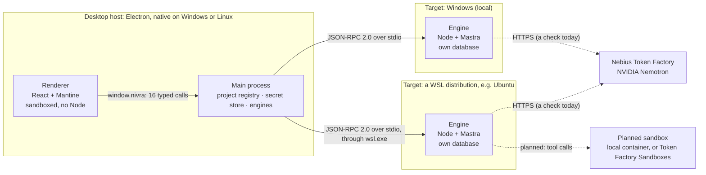
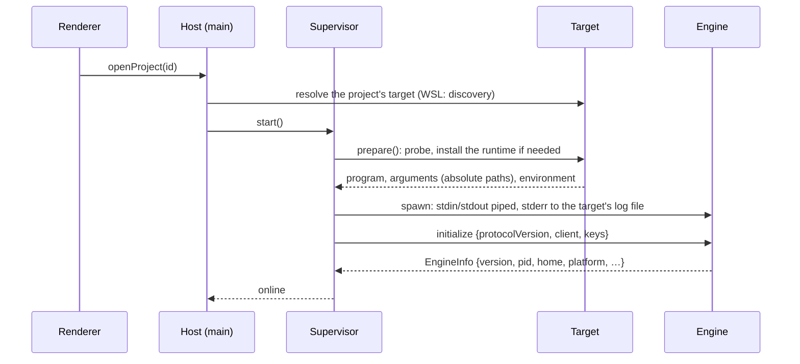
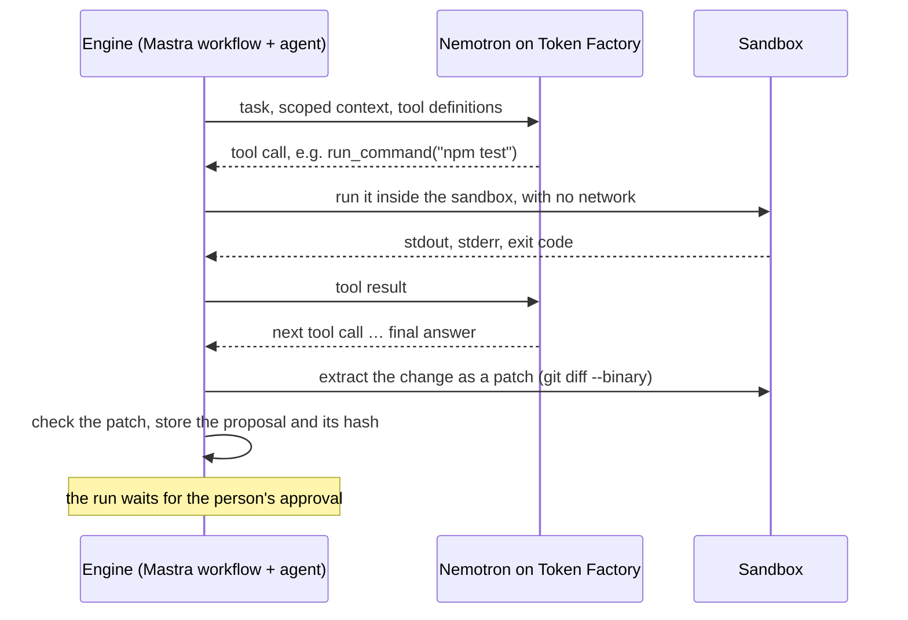
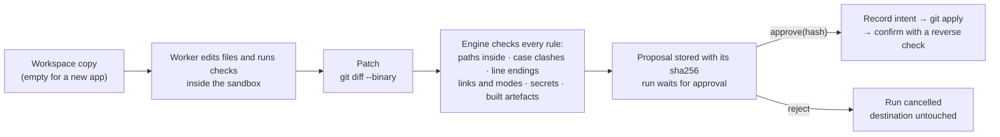

# Nivra: system architecture

*Status as of 17 October 2026.*

This document describes the **foundation** change set:
- the desktop host and its engines;
- the protocol between them;
- runs, packaging and local verification;
- decisions D17 and D18.

It also describes what is **planned** after it. **The planned features are not working yet:**
- the AI worker;
- the sandboxes that would enforce limits on it;
- explanations;
- preferences;
- patch approval.

Each section says which parts are built and which are planned. Decisions are cited as D1, D2, … and are written up in
[docs/decisions.md](docs/decisions.md). The questions about the hackathon's requirements are kept apart from the
architecture, in §17.

---

## 1. What Nivra is

Nivra is a desktop workspace for software engineers. It is being built for the Nebius × NVIDIA Global AI Hackathon
(submissions close 30 October 2026 at 10:00 PT). The proof of concept aims at one scenario, end to end:

> "Explain this repository using evidence. Remember my confirmed preference. Start a new small web app using my
> relevant defaults. Show me the proposed choices before making changes."

Three design rules shape the architecture:

1. **The model reasons; Nivra executes.**
   - NVIDIA Nemotron, served by Nebius Token Factory, only ever takes text in and gives text back. That includes tool
     calls; it never runs code itself.
   - In the planned coding workflow, Nivra's engine on the person's machine carries out each tool call inside a sandbox
     and returns the result.
   - Today the engine runs only a built-in check (the hello run), Doctor and a Token Factory check.
2. **Work runs where the code lives.** A repository is read, built and changed by the operating system that owns its
   files:
   - a folder inside a WSL distribution by an engine in that distribution;
   - a folder on a Windows drive by a Windows engine;
   - a folder on Linux by a Linux engine.
3. **An approval is not a boundary.**
   - Consequential actions will be either enforced by a sandbox or refused. Nothing falls back silently to running
     unconfined, or somewhere else.
   - No such action exists yet. The only execution backend today, `Local`, provides no isolation, and it runs nothing
     but the hello check and git.

## 2. The system at a glance



| Layer | What it is | What it may do |
|---|---|---|
| **Renderer** | The window: React 19 + Mantine 9 | Call 16 named functions. It sees project ids and display paths. It holds a key only while the person types it into Settings, and it never reads a saved key back. It can't choose a path for a privileged operation: folders come from the native dialog in main. |
| **Main process** | Electron's main process, a thin shell over plain Node modules | Own the project list, the secret store and the engines. Translate the window's calls into engine calls. |
| **Engine** | One Node process per target in use, each with its own databases | Today: the hello run, Doctor, run records and a Token Factory check. Planned: model workflows and sandboxes. It speaks only JSON-RPC on stdin and stdout. |

The engine is never part of Electron. It runs on its own Node, shipped with the app (D5), which is what lets it run
inside a WSL distribution while the window stays native on Windows.

## 3. Repository layout

```
apps/desktop/        Electron host
  src/main/            index.ts (Electron shell) · host.ts (core) · supervisor.ts · host-store.ts · secret-store.ts
                       paths.ts · targets/ (local, wsl, wsl-discovery, registry, process)
  src/preload/         the typed bridge, window.nivra
  src/renderer/        React + Mantine UI: projects, engine, wsl, hello, doctor, settings
  src/shared/ipc.ts    the bridge contract (every call is added here first)
  scripts/             runtime staging, the Windows build loop, the Windows verification harness
  e2e/                 Playwright tests: built app, packaged app, packaged Windows app
apps/engine/         the engine
  src/main.mjs         unbundled launcher that keeps stdout for the protocol
  src/engine.ts        createEngine(): RPC router, run store, scheduler, Mastra, execution backend
  src/runs/ src/db/    run store and scheduler on node:sqlite, with migrations
  src/workflows/       Mastra workflows (hello only, today)
  src/exec/            the Local execution backend, child environment, process-tree kill
  src/providers/       Nebius Token Factory client and the Nemotron probe
  src/doctor/ src/secrets/   environment checks; the in-memory key vault
packages/domain/     zod contracts shared by host and engine: protocol, methods, runs, RpcClient
docs/                decisions (D1–D19), acceptance, provenance (code reused from Hird), development
```

**Toolchain** (exact pins, D11): Node 24.21.0, pnpm 10.4.1, Electron 44.7.0, React 19.3.0, Mantine 9.7.1, Mastra
(`@mastra/core` 1.75.0, `@mastra/libsql` 1.25.1), zod 4.6.5, TypeScript 5.9.3, Playwright 1.64.0.

**Provenance.** Concepts and some code come from the author's earlier app, Hird. Every reused file is listed with its
source commit, marked ported or rewritten, in [docs/provenance.md](docs/provenance.md).

---

## 4. Desktop host *(built)*

### 4.1 Renderer
- **Locked down.**
  - It runs with `sandbox` and `contextIsolation`, and without `nodeIntegration`.
  - A strict Content Security Policy applies: `default-src 'self'; script-src 'self'; …; object-src 'none'`.
  - Navigation away from the app, pop-ups, webviews and permission requests are all denied.
  - It imports shared types only, never zod at runtime, because zod's runtime checks would trip the CSP.
- **Ids, not paths.**
  - It sends project ids, never paths.
  - It shows each project's path for display only.
  - Folders come from the native dialog, which runs in main.
- **Keys.** A key typed into Settings sits in the renderer until it is saved. After that, the renderer sees only how the
  key is stored (encrypted, unencrypted, unreadable), never the key.
- **What it shows:**
  - every repository with its target label ("Ubuntu · WSL", "Windows · Local"), and Add/Remove;
  - the engine badge and notices for the chosen project;
  - WSL guidance (Windows only);
  - a hello run with a live timeline and Cancel;
  - Doctor;
  - Settings: the Nebius key, and a Token Factory check.

### 4.2 The bridge
`window.nivra` exposes 16 named functions, each invoking exactly one IPC channel. There is no generic "send any channel"
helper. Every handler in main checks two things before acting:
- the sender is the top frame of one of Nivra's windows, at the exact app URL;
- the arguments pass zod validation.

| Call | Purpose |
|---|---|
| `listProjects`, `addProject`, `removeProject` | The project registry. `addProject` opens the native folder dialog in main. |
| `openProject(projectId)` | Starts that project's engine if it isn't running yet. It never starts a different one. |
| `listEngines` | The state of every engine a project uses. Asking starts nothing. |
| `restartEngine(projectId)` | Restarts the project's engine, or checks its distribution again. |
| `getWsl`, `checkWsl` | What WSL offers on this machine, and how to fix it (Windows only). |
| `startHello(projectId, holdMs)`, `runEvents(runId, after)`, `cancelRun(runId)` | Runs. |
| `runDoctor(projectId)` | Environment checks on that project's engine. |
| `getSettings`, `setNebiusKey` | How the saved key is stored; save or remove it. |
| `checkTokenFactory(projectId)` | Lists the NVIDIA models and makes one Nemotron tool call, from that project's engine. |
| `getAppInfo` | Versions. |

### 4.3 Main process
- **`index.ts`**: the Electron shell. It owns the window, the security guards, single-instance handling, dialogs, the
  IPC handlers and the quit flow.
- **`Host`** (`host.ts`): the core, with no Electron in it. It holds the project registry, keeps one engine per target,
  routes calls, and produces the WSL guidance (D17).
- **`EngineSupervisor`**: starts, watches and stops one engine. Its states are `stopped`, `starting`, `online` and
  `failed`, and a failure carries a code and a reason.
- **Targets**: `LocalTarget`, `WslTarget`, WSL discovery, and a target factory.
- **`HostStore`**: projects and window state, as JSON in Electron's user-data folder. Writes are atomic, with retries
  for Windows renames.
- **`SecretStore`**: the Nebius key, saved in `secrets.json`. It is encrypted with Electron `safeStorage` where a
  keychain is available. Otherwise it is stored unencrypted, and the window says so.

A source-rule test keeps `host.ts`, the targets, the supervisor and the stores free of Electron (D12). That lets
`node --test` drive them on Linux and from a real Windows process.

---

## 5. Targets: where an engine runs *(built; D1, D10, D17)*

### 5.1 The folder decides, once
Nobody chooses a target. It is set when a folder is added, by the operating system that owns the folder:

| Folder picked in the dialog | Target | Recorded path |
|---|---|---|
| `C:\Users\me\app` (a Windows drive) | `local`, the native Windows engine | `C:\Users\me\app` |
| `\\wsl.localhost\Ubuntu\home\me\app` (or `\\wsl$\…`) | `wsl:Ubuntu` | `/home/me/app` |
| `\\wsl.localhost\Ubuntu\mnt\c\Users\me\app` | `local`: Windows owns drive C: | `C:\Users\me\app`, with a notice |
| `\\server\share\…` | refused: network shares aren't supported | — |
| `/home/me/app` (Linux host) | `local` | `/home/me/app`; a `/mnt/<drive>` folder inside WSL gets a slow-drive warning |

**The rules**
- A project's target never changes.
- WSL is never chosen just because it is installed.
- There is no fallback. A project whose distribution is missing or unusable says why and what to do; it is never run
  on another target.
- A WSL folder is checked when it is added. The distribution must exist and must not be Docker Desktop's. It must be
  WSL 2 and x86-64, with glibc 2.28 or newer and `tar`. A missing `git` is a warning.

### 5.2 WSL discovery and guidance *(Windows hosts)*
- **Language-independent.**
  - `%ProgramFiles%\WSL\wsl.exe` must exist and answer `--version`.
  - Names come from `wsl --list --quiet`.
  - The version, default distribution and default user come from the registry (`HKCU\…\Lxss`), never from the
    localised `--list --verbose`.
  - Errors are recognised by their `WSL_E_*` code.
- **Background only.** Discovery runs in the background at startup and never holds up Windows folders.
- **Always explained.** The window always says what WSL offers, with the command that fixes it and a **Check again**
  button. Possible states:
  - missing;
  - outdated;
  - not answering, with WSL's code;
  - no distribution Nivra can use: none, only Docker Desktop's, or only WSL 1 ones.

### 5.3 One engine per target, and routing
- **Lifetime.** An engine starts the first time a project on its target is opened, and runs until the app quits.
- **Routing.**
  - Project calls go to the engine of the project's folder.
  - Run calls go to the engine that started the run, through a run-to-target map kept in main.
- **What follows.**
  - Looking at another project never stops an engine.
  - No call can reach the wrong engine. A runtime target switch used to allow exactly that, which is why it was
    removed (D17).

### 5.4 Starting an engine



- **Native Windows and Linux.** The Node shipped with the app (`resources/runtime/<os>-<arch>/node`) runs
  `engine/main.mjs`.
- **WSL.** The command is `wsl.exe -d <distro> --cd <home> --exec <home>/.nivra/runtime/<hash>/node/bin/node …/engine/main.mjs …`.
  Every path is absolute, because `--exec` runs no shell and would not expand `~`.
- **Installing the runtime in WSL (D5).** On first use, a short, fixed `/bin/sh -c` script runs inside the distribution
  (§8). The app streams a deterministic Linux tarball to it over `wsl.exe`'s standard input. The script:
  1. extracts the tarball into a temporary folder;
  2. checks that Node, `node:sqlite` and the libsql driver load;
  3. renames the folder into place under the tarball's content hash.
  
  A runtime already installed under the same hash is reused: a second start took about 0.7 s. The newest two runtimes
  are kept.
- **Configuration travels only as arguments:** `--stdio --home <abs> --instance <uuid> --heartbeat-ms <n> --nivra-engine`.
  Environment variables don't cross `wsl.exe` (D3).
- **Time limits**, in order:
  1. probing the distribution: up to 60 s;
  2. installing the runtime: up to 300 s;
  3. once the engine process runs, `initialize` must answer within 60 s.
  
  A runtime that fails to load is installed again, once. Every failure says what happened, with a code and the tail
  of the engine's log.

### 5.5 Watching and stopping *(D4, D18)*
- **Heartbeat.**
  - The host pings each engine six times per heartbeat (30 s by default).
  - An engine that is alive but hasn't answered for longer than a heartbeat is marked failed with code `unresponsive`.
    It is stopped in the quit order below, and **Restart** starts a fresh one.
  - After the machine wakes from sleep, silence isn't counted for one heartbeat (D18).
- **Exits.** An engine that exits unexpectedly is shown as "The engine stopped unexpectedly (exit code …)" with a
  Restart button. The host doesn't guess at causes it can't see.
- **The engine stops in one way**, whichever of these triggers it:
  - the `shutdown` call;
  - the end of its standard input;
  - a broken stdout;
  - SIGTERM or SIGINT;
  - its own watchdog, when the host goes silent for longer than the heartbeat.
  
  It then stops its runs (with a 3 s grace period), closes its database, flushes its last reply and exits.
- **The host's quit order** for each engine:
  1. send `shutdown` and wait up to 5 s;
  2. close stdin and wait up to 2 s;
  3. force it to stop:
     - on Windows, with `taskkill /T /F`;
     - in WSL, by killing `wsl.exe`, then running `pkill -f -- --instance <uuid>` inside the distribution. That pattern
       never matches a developer's own engine.
- **Quitting.** On quit, every engine closes in parallel, and a closed supervisor refuses to start again.
- **Crashes.** On Windows, engines are spawned non-detached, so libuv's job object takes them down if the app itself
  dies.

---

## 6. Host ↔ engine protocol *(built, D2)*

- **Transport.** JSON-RPC 2.0 over the engine's stdin and stdout, one message per line (NDJSON). Lines are capped at
  8 MiB, and `PROTOCOL_VERSION` is checked in `initialize`.
- **Stdout carries the protocol and nothing else.**
  - A small unbundled launcher keeps the real stdout writer for the protocol, and sends every other stdout write and
    every `console.log` to stderr.
  - Mastra's logger is off.
  - Tests assert that every stdout line parses as JSON-RPC.
  - Source-rule tests ban `stdio: 'inherit'`, `shell: true`, and `process.exit` outside the launcher.
- **Validation.** Both sides validate parameters and results with the same zod schemas, from `packages/domain`.

| Method | What it does |
|---|---|
| `initialize` | Version handshake; hands over the keys; returns `EngineInfo`. |
| `secrets.update` | Replaces keys in the engine's memory. |
| `ping` | Heartbeat. |
| `shutdown` | The single stop path. |
| `doctor` | Checks the engine, its data folder and git, and which execution boundaries this target could offer (detection only). |
| `providers.check` | Token Factory: the NVIDIA models the key can see, then one Nemotron tool call. |
| `runs.start`, `runs.get`, `runs.list`, `runs.events`, `runs.cancel` | Runs (§7). |

**Notifications.** The engine sends one notification, `engine.fatal`, as its last word before it exits on a startup
failure. It carries a code: `locked`, `bad-arguments`, `home-unusable`, `runtime-broken` or `crashed`. The host reads
run progress by polling with a cursor.

---

## 7. Runs *(built)*

- **States.**
  - `queued → running → succeeded | failed | cancelled`, with checked transitions.
  - `waiting_for_approval` exists in the state machine, but nothing enters it yet (§11).
- **Storage.**
  - Each engine keeps runs in its own `nivra.db` (`node:sqlite`): a `runs` table and an append-only `run_events`
    timeline, numbered per run.
  - Clients read Nivra's tables, never Mastra's.
- **Events.**
  - Types: `run.*`, `step.*`, `step.output`, `command.started`, `command.finished`.
  - Data is capped at 8 KiB per event and messages at 2,000 characters.
  - Before anything is stored, the run store replaces the values of the keys Nivra holds. That is masking of known
    values only: it is not a general secret detector.
- **Scheduling.**
  - At most 2 runs at a time, in submission order.
  - Each run is a Mastra workflow run with the same id.
  - Cancel aborts the step's signal, which stops the whole process tree:
    - POSIX: SIGTERM, then SIGKILL, on the run's process groups;
    - Windows: a job object plus `taskkill /T /F`.
- **Restart.** A run still marked running when its engine starts again is failed with `run.interrupted`. It is never
  replayed: Mastra's automatic restart is off.
- **The `hello` workflow** proves the chain without changing anything. Its steps:
  1. engine information;
  2. the repository's working directory and real path;
  3. `git --version`;
  4. `git status --porcelain=v2 --branch`;
  5. optionally, a held child process, which shows that Cancel really stops work.

---

## 8. Security model *(built)*

| Area | What is enforced today |
|---|---|
| Electron | Sandbox, context isolation, CSP and a single instance. Navigation, pop-ups and permissions are denied. Fuses turn off RunAsNode and `NODE_OPTIONS`, and the app loads only from its asar archive. |
| IPC | A trusted-sender check and zod validation on every handler. The renderer sends ids; the paths it shows are for display only. |
| Starting programs | Programs start from argument lists, never through a shell, and a test bans `shell: true`. The one exception is probing and provisioning a WSL distribution: a fixed `/bin/sh -c` script runs inside it, with values passed as positional arguments, never spliced into the script. |
| Child environments | Children get a filtered environment: provider key variables, `NODE_OPTIONS` and Electron's variables are removed, and exactly one PATH key is kept. This removes **known** variables; it is not an allow-list, so other secrets in the environment are passed on. |
| Execution | Only the `Local` backend exists. It provides **no isolation** and is labelled "No isolation". It refuses sessions that need network rules, and Windows batch files. Today it runs only the hello check and git. The container, Token Factory Sandboxes and OpenShell backends are planned (§11). |
| Databases | Each database has one owner, and none is ever opened across the Windows/WSL boundary. SQLite's exclusive lock refuses a second engine on the same data folder. |

**The API key's path (D8)**
1. The person types the key into Settings. The renderer holds it until it is saved.
2. The host saves it in its secret store, `secrets.json`. It is encrypted with `safeStorage` where a keychain is
   available. Otherwise (Linux's `basic_text` and `unknown` backends) it is stored unencrypted with a warning, and
   re-encrypted once a keychain appears.
3. The key reaches an engine only through `initialize` and `secrets.update`. The engine holds it in memory.
4. The key is not passed in environment variables or command-line arguments. The engine removes provider variables from
   its own environment at start.
5. The engine never writes the key to its databases, logs, run input or events.
6. A canary test checks that a fake key never reaches `nivra.db*`, `mastra.db*` or the logs.

## 9. Data and storage *(built)*

| Data | Owner | Where | Notes |
|---|---|---|---|
| Projects, window state | Host | `<userData>/nivra.json` | Atomic writes |
| Nebius key | Host | `<userData>/secrets.json` | Encrypted where a keychain is available, otherwise unencrypted with a warning; engines hold a copy in memory only |
| Runs and events | Each engine | `<home>/nivra.db` | `node:sqlite`, exclusive lock; known key values masked |
| Workflow snapshots | Each engine | `<home>/mastra.db` | libsql, through Mastra. **Not covered by the run store's masking**: Mastra stores workflow input and step results as they are. Today's only workflow, hello, stores a repository path and a hold time. Planned workflows must pass ids, never sensitive content. |
| Engine logs | Host | `<logs>/<target>.log` | The engine's stderr; the previous log is kept |
| WSL runtime | — | `~/.nivra/runtime/<hash>`, inside the distribution | The newest two are kept |

**Engine data folders:**
- Windows: `%LOCALAPPDATA%\Nivra\engine`.
- Linux, and inside WSL: `~/.nivra`.
- Development: `~/.nivra-dev`.

*Planned:*
- the host gains preferences and per-project data-sharing flags;
- the engine gains artifacts, patches, approvals, apply intents and sandbox sessions, through an additive migration.

---

## 10. Models: Nebius Token Factory

**Built**
- **`providers.check`** runs from any engine:
  1. it lists `GET /v1/models`;
  2. it picks a Nemotron model the key can see, preferring `nvidia/nemotron-3-super-120b-a12b`, then
     `nvidia/Nemotron-3_5-Lightning`, then `nvidia/Nemotron-3-Ultra-550b-a55b`;
  3. it makes one tool call through Mastra.
  
  There are no retries (`maxRetries: 0`). Listing the models has a 30 s limit and the call 120 s. Errors are mapped by
  status: key refused (401/403), rate-limited (429), unreachable, no NVIDIA model. Token counts are shown when the
  provider reports them.
- **`pnpm probe:tokenfactory`** makes the same check from a terminal.
- **Not yet run with a real key.**

**Planned**
- **One `ModelClient`** for every model call:
  - no retries;
  - a time limit on every step;
  - usage recorded per call, as `null` when it isn't reported (never shown as 0);
  - errors mapped by status code or error class.
- **Model tiers.** `reasoning` and `agent` use Ultra or Super; `fast` uses Nano or Lightning. The tier is recorded on
  every call. The final choices depend on which models the key can see and which handle tools reliably.
- **Offline tests.** Tests never call real models. They use a mock model in-process, or a stub server reached through
  a test-only, loopback-only engine argument.

---

## 11. Coding work *(planned; nothing in this section is implemented)*

Today the only execution backend is `Local`, which provides no isolation and runs nothing but the hello check and git.
The design below follows D9 and D15. It will be recorded in new decisions as it is built.

### 11.1 The agent loop
The planned worker is a Mastra agent on Nemotron that runs inside the engine. The model proposes actions; the engine
carries each one out in a sandbox and returns the result.



- **Tools:** `list_files`, `read_file`, `grep_search`, `write_file`, `run_command`. Paths are checked against the
  workspace, and output is masked and capped before the model sees it.
- **Limits:** a step limit and a time limit. Cancel aborts the model call and closes the sandbox.
- **The key stays out of the sandbox.** The key stays in the engine, which makes the model calls, so the sandbox needs
  no route to the model.
- **Adapter.** A `CodingWorker` adapter declares the worker's capabilities, so another worker (OpenCode, say) can be
  added later.

### 11.2 Sandboxes
`SandboxBackend` will be a type of its own, separate from today's `ExecutionBackend`, so that `Local` can never be used
for coding work.

| Backend | Role | What it would enforce | Availability |
|---|---|---|---|
| **Docker or Podman container** | Intended local default | Only a copy of the workspace is mounted, never the person's checkout. No network. A non-root user with all capabilities dropped, no new privileges, and process and memory limits. | Needs Docker Desktop's WSL integration, Docker Engine or Podman. Not built. |
| **Token Factory Sandboxes** | Cloud option | A disposable remote VM with network on or off. Commands run as subprocesses of a live instance. | **Beta, access by request.** Requested, not active: not an available path today. Not built. |
| **NVIDIA OpenShell** | Optional, stricter local sandbox | Landlock filesystem rules, a per-host network allow-list, credential placeholders | Linux and WSL with Docker or Podman. Not built; first to cut if time runs short. |

**Network**
- The model's commands will never have network access.
- Template and install steps (`npm create vite …`, `npm install`):
  - come from the approved plan;
  - are run by the engine, never the model;
  - need one explicit consent from the person;
  - run in a separate, short-lived networked container against the same workspace.
  
  On Token Factory, the equivalent is a networked instance that saves a checkpoint image, followed by an instance with
  no network.

**Choosing a sandbox.** Settings chooses the sandbox, separately from the target. A run whose sandbox is unavailable is
refused with what is missing. Installing the app needs no Docker; coding locally will.

### 11.3 From workspace to applied change



- **Who writes.** Only the engine on the operating system that owns the destination writes it. The host and the
  renderer never write repository files (D15).
- **Approval.** The person approves the exact patch they were shown, identified by its hash. A different hash is
  refused.
- **Restarts.**
  - A proposal waiting for approval survives a restart, because nothing is running.
  - An apply that was interrupted is inspected and reported as applied, not applied or unknown. It is never applied
    twice.
- **First version:** new-app scaffolds into an empty folder. Changes to existing repositories come later.

---

## 12. Context, explanation and preferences *(planned; not implemented)*

- **Local repository map.**
  - Contents:
    - the file tree, with the secrets deny list applied;
    - manifests;
    - convention files;
    - an outline of exported symbols.
  - It is cached by checkout (HEAD plus whether the tree is dirty), and needs no new dependencies.
  - The model starts from this overview and fetches details with tools.
- **Explain with evidence.**
  - Answers cite `path:line`.
  - The engine checks each citation against the lines it actually showed the model, and reports the result (for
    example "11 of 12 citations verified").
  - Tokens and latency are recorded per call.
  - The stack and conventions are extracted as candidate preferences.
- **Data sharing.**
  - Each project gets two flags, both off until the person agrees:
    - `modelContext`: repository excerpts may go to Token Factory;
    - `cloudExecution`: a copy of the repository may go to Token Factory Sandboxes.
  - The deny list (`.env` files, keys, and so on) and size caps always apply.
  - Each run records which paths it sent and how many bytes, never the content.
  - Repository text can never change these settings.
- **Preferences.**
  - Owned by the host.
  - Scoped as personal or per project, and marked suggested or confirmed.
  - Editable, replaceable by a newer preference, and deletable.
  - Each run receives a scoped snapshot.
- **Context assembly.**
  - Precedence: an explicit task override first, then the repository's conventions (with evidence), then personal
    defaults.
  - One project's decisions never appear in another project.
- **New-app flow.**
  1. Plan preview: the stack, the preferences that shaped it and where each came from, the commands, the sandbox and
     its network.
  2. Start.
  3. Proposal: the checks, the diff and the verification results.
  4. Approve by hash.
  5. The engine applies the patch.
  6. Result view.

---

## 13. Packaging and distribution *(built)*

- **Runtime staging per target** (`stage-runtime.ts`, D5, D6):
  - Node 24.21.0, checked against nodejs.org's published checksums;
  - an esbuild bundle of the engine and the shared contracts;
  - the engine's production `node_modules` for that target, including libsql's prebuilt native driver;
  - `manifest.json`, with a content hash;
  - a deterministic Linux tarball, for WSL;
  - a guard against Windows' 260-character path limit;
  - the Visual C++ runtime DLLs next to `node.exe`; staging fails if they are missing.
- **Builds** (electron-builder):
  - Linux: a deb (the primary artifact) and an AppImage.
  - Windows: an unsigned zip. An NSIS installer needs a Windows build machine.
  - Runtimes sit outside the asar archive, under `resources/runtime/<os>-<arch>`. The Windows build also carries the
    Linux tarball for WSL.

**Platforms, as verified so far**

| Host | Folder | Status |
|---|---|---|
| Windows 10/11 x64 | Inside a WSL2 distribution (glibc 2.28+, x86-64) | Hello run, cancel and quit verified through the packaged app; the primary target |
| Windows 10/11 x64 | On a Windows drive | Hello run and Doctor verified; coding work comes later |
| Linux x64 | Local | Hello run, cancel and quit verified through the built and packaged app |
| macOS | Local | Deferred (D10) |

## 14. Verification *(D14: no CI; every check runs on the developer's machine)*

**What each check covers**

| Check | Coverage |
|---|---|
| `pnpm verify` | Typecheck and every unit and integration test, including real engines over stdio. See the list below. |
| `pnpm verify:windows` | The target and supervisor modules, driven by a real Windows process: native and WSL engines; start, hello, cancel, stop; engines killed from outside and restarted; engines dying with their parent |
| `test:packaged` | The packaged Linux app (`electron-builder --dir`), through its real UI |
| `test:windows` | The packaged Windows app, driven from WSL: both engines in one session, a WSL run kept alive and cancelled while the native engine works, and quit leaving nothing running |
| `test:e2e` | The built Linux app, through its real UI |

The integration tests in `pnpm verify` include:
- stdout purity;
- the secrets canary;
- cancel stopping the process tree;
- the engine exiting when its input ends;
- the watchdog;
- `run.interrupted` after a restart;
- the database lock;
- paths containing spaces, `ü`, `%` and `#`;
- an engine that stops answering, and the grace period after a wake;
- the engine pool:
  - routing by folder;
  - a run kept on its own engine while another engine restarts slowly;
  - no fallback for a missing distribution;
  - every engine stopped on quit.

**Recorded results from earlier runs**, before the final changes:

| Date | Check | Result |
|---|---|---|
| 16 Oct | `pnpm verify:windows` (bootstrap) | 15/15 |
| 17 Oct | `pnpm verify` (D16 fixes) | 88/88 |
| 17 Oct | `pnpm verify`, `test:e2e`, `test:packaged`, `verify:windows`, `test:windows` (D17, before D18) | 114/114 · 5/5 · 5/5 · 15/15 · 5/5 |

**Results against the final change set** (code and docs as they are to be committed):

These were run on 17 October 2026 (05:16–05:35 +08:00) against the working tree with all code changes in place. The
only edits made afterwards record these results, here and in `docs/acceptance.md`. Markdown is neither built nor
tested.

| Check | Result |
|---|---|
| `pnpm verify` | Typecheck clean; tests 116/116 (domain 19, desktop 56, engine 41) |
| `pnpm verify:windows` | 17/17. Runtimes staged afresh with unchanged content hashes: `linux-x64` `bfa3b1d6eef1f011`, `win-x64` `450da327920b7e9d`. |
| `pnpm --filter @nivra/desktop package:dir`, then `test:packaged` | 5/5 |
| `pnpm dev:win --no-launch`, then `test:windows` | 5/5 |
| `test:e2e` | 5/5 |
| Real engine over RPC: `pnpm rpc doctor`, then a hello run with `--follow` | Doctor: engine, home and git `ok`; boundaries `warn` (no sandbox yet). The hello run succeeded. The engine's own code is unchanged in this change set. |

**Not yet run** (still pending):
- the installed deb on a stock Ubuntu (an unpacked build test is not installation coverage);
- the Windows zip on a clean machine without the Visual C++ redistributable;
- a real Token Factory key;
- Token Factory Sandboxes;
- terminating a whole WSL distribution while the app runs (the checks run from inside that distribution);
- macOS.

---

## 15. Status and roadmap

| Area | Status | Linear | When |
|---|---|---|---|
| Desktop host, targets, protocol, engine core, runs, engine recovery, packaging, local checks | **Built**: the foundation change set | NIV-3 (In Review), NIV-5 (In Progress; sending preferences to engines waits for NIV-10) | Now |
| Scope decisions: fixtures, the bounded scaffold, data sharing, out-of-scope list | Planned | NIV-2 | 19–20 Oct |
| Engine core v2: protocol v2, storage v2, approvals | Planned | — | 20–21 Oct |
| Explain with evidence, `ModelClient`, tiers, repository map | Planned | NIV-6, NIV-9 | 21–22 Oct |
| Worker, sandboxes, patches, approvals, apply | Planned | NIV-7, NIV-8 | 22–25 Oct |
| Preferences, context assembly, new-app flow, result view | Planned | NIV-10 – NIV-13, NIV-5 | 26–27 Oct |
| Acceptance on packaged builds, release, video, submission | Planned | NIV-14 – NIV-17 | 28–30 Oct |

A checkpoint on 22 October applies a fixed cut order if the schedule slips. None of the planned work is a precondition
for committing the foundation.

## 16. Decision index

| # | Decision |
|---|---|
| D1 | The window is native; the engine runs where the repository lives |
| D2 | NDJSON JSON-RPC 2.0 over stdio; stdout carries nothing else |
| D3 | Configuration crosses process boundaries as arguments or RPC, never as environment variables |
| D4 | One way to stop an engine, and a fixed quit order |
| D5 | Nivra ships its own Node and engine for every target |
| D6 | No native addons in Electron; the engine's one addon ships with its runtime |
| D7 | One owner per database |
| D8 | Secrets live in the host's secret store and in engine memory, nowhere else |
| D9 | Execution boundaries are pluggable sessions that declare what they enforce |
| D10 | Supported platforms for the proof of concept; macOS deferred |
| D11 | Toolchain pinned |
| D12 | Targets, the supervisor and the host core don't import Electron |
| D13 | Entered in the Coding and Agentic Engineering track (its Sandboxes statement is superseded by D19) |
| D14 | Cross-platform checks run locally, not in CI |
| D15 | Agents write in a workspace the engine owns; changes reach a checkout only as an approved patch |
| D16 | Fixes from the first code review |
| D17 | The folder decides where work runs; one engine per target for the session |
| D18 | An engine that stops answering is reported and stopped |
| D19 | Hackathon requirements, as published |

The planned work in §§10–12 will be recorded as new decisions as it is built.

## 17. Hackathon requirements *(kept separate from the architecture)*

- **What every entry needs.** The published rules' general platform requirement is runtime use of Nebius Token Factory
  inference with an NVIDIA model. Nivra meets it through its model calls: `providers.check` today, and the planned
  workflows.
- **Still open.** The Coding and Agentic Engineering track's wording about operating within Token Factory Sandboxes
  needs clarification from the organisers. That clarification has **not** been obtained, and nothing here assumes the
  answer.
- **No OpenShell bonus.** The rules publish no scoring bonus for NVIDIA OpenShell.
- **Sandboxes isn't available yet.** Token Factory Sandboxes is in beta and needs an access request. Access has been
  requested and is not active, so it can't yet be described as an available, zero-setup way to run code.
- **Effect on the design.** None either way. The answer only decides which sandbox the demonstration uses; it is
  tracked in NIV-15 (D19).

## 18. Questions for reviewers

1. **Local isolation.** Is a hardened Docker or Podman container an adequate local boundary for commands a model
   proposes? The planned container has no network, a non-root user, no capabilities, no new privileges and resource
   limits, and only a workspace copy mounted.
2. **Network for installs.** Template and install steps get network access only with consent, only from the approved
   plan, and only when run by the engine. The model's own commands stay offline. Is that the right line?
3. **Approvals across restarts.** Should a stored proposal stay approvable after the app restarts, or expire?
4. **Scope.** Is new-app scaffolding enough for the first version, with changes to existing repositories later?
5. **Model tiers.** Ultra or Super for planning and tool loops, Nano or Lightning for small jobs: is that the right
   split?
6. **Native Windows.** Windows-drive folders get the hello run and Doctor today. Coding on them would need Docker
   Desktop or Token Factory Sandboxes. Is that acceptable for the proof of concept?
7. **Judges.** Explaining will need only a Token Factory key. Coding will need Docker or Podman, or Sandboxes access.
   What should the judges' setup be?
