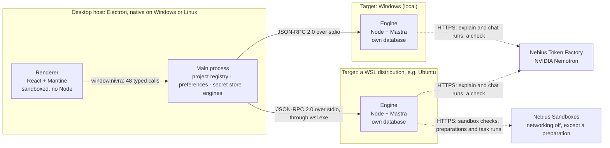
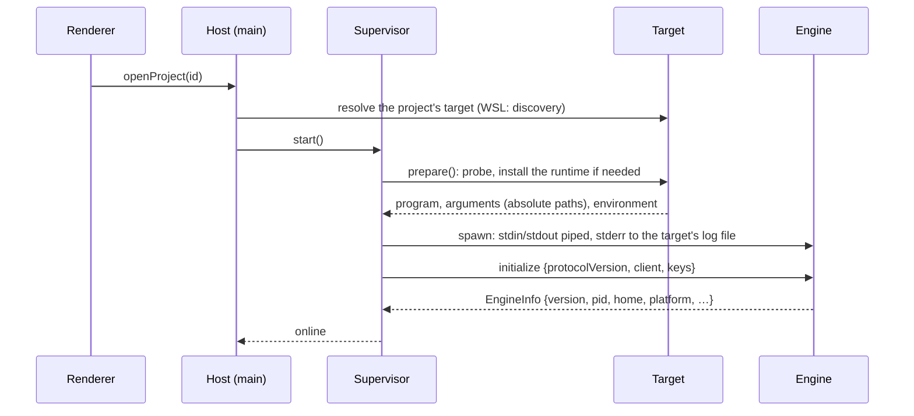
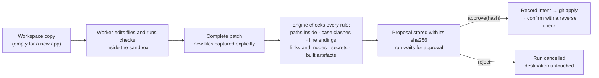

# Nivra: system architecture

*Status as of 17 October 2026, with coding work brought up to date on 28 October (D39 to D41).*

This document describes what is **built**:
- the desktop host and its engines;
- the protocol between them;
- runs, packaging and local verification;
- decisions D17 and D18;
- the preference store owned by the host, and the snapshot each run receives (D21);
- explaining a repository with evidence on NVIDIA Nemotron through Token Factory, with per-project consent and
  citations checked against what the model was shown (D22). It is tested offline against a stub and has run live on
  both fixtures;
- context assembly (D23): task choices, five-rank precedence ranked by the engine, an inspectable context view, and the
  preference lifecycle (intent, supersession, keeping a suggestion, export and import). It is tested offline, including
  the D20 sequence through the UI, and ran live on both fixtures on 18 October.
- packaged acceptance (D24): the whole D20 journey, with its failure cases, ran live on the Linux deb and on the Windows
  zip driving WSL, from one release candidate (`ead56e8`), and passed every criterion on both. Candidate 0.1.1
  (`cad5eca`, D25) moves the Windows runtime's Visual C++ DLL beside the addon that imports it. Its Linux and WSL
  payloads are byte-identical, so that evidence carries over, and its Windows checks ran again.

Since then, coding work has been built behind an execution boundary that enforces its limits:
- a task's run: one worker on Nemotron in a Nebius sandbox with networking off, judged by acceptance cases it can't
  edit, its change proposed as a checked patch with its hash (D39);
- the person's approval by that hash, and the apply by the engine that owns the checkout, every end said exactly (D40);
- a project's environment: one pinned Node and pnpm setup prepared inside Nebius from the commit's manifests, then
  baseline checks before the model and frozen files the worker can't change (D41).

The decisions are the current record for these. Where a section below still calls them planned, the decision wins.

It also describes what is **planned**, in two parts. **None of it is working yet.**
- **The rest of the immediate milestone (D20):** promoting a project's preference to a personal one (NIV-10).
- **Later:** new-app creation, a local container sandbox, and more workers.

Each section says which parts are built and which are planned. Decisions are cited as D1, D2, … and are written up in
[docs/decisions.md](docs/decisions.md). The questions about the hackathon's requirements are kept apart from the
architecture, in §17.

---

## 1. What Nivra is

Nivra is a desktop workspace for software engineers. It is being built for the Nebius × NVIDIA Global AI Hackathon
(submissions close 30 October 2026 at 10:00 PT). The immediate milestone (D20) aims at one read-only scenario, end to
end:

> "Explain this repository using evidence. Remember the preference I confirm. Show that it follows me to another
> project without overriding that project's own conventions, and that editing or deleting it changes what happens
> next."

New-app creation was part of the original scenario. It is deferred to a later milestone, with the coding work it needs
(§11).

Three design rules shape the architecture:

1. **The model reasons; Nivra executes.**
   - NVIDIA Nemotron, served by Nebius Token Factory, only ever takes text in and gives text back. That includes tool
     calls; it never runs code itself.
   - In the planned coding workflow, Nivra's engine on the person's machine carries out each tool call inside a sandbox
     and returns the result.
   - Today the engine runs a built-in check (the hello run), the read-only explain run, Doctor and a Token Factory
     check. Explaining reads the repository through fixed, read-only tools; the model never runs anything.
2. **Work runs where the code lives.** A repository is read, built and changed by the operating system that owns its
   files:
   - a folder inside a WSL distribution by an engine in that distribution;
   - a folder on a Windows drive by a Windows engine;
   - a folder on Linux by a Linux engine.
3. **An approval is not a boundary.**
   - Consequential actions will be either enforced by a sandbox or refused. Nothing falls back silently to running
     unconfined, or somewhere else.
   - No such action exists yet. The only execution backend today, `Local`, provides no isolation, and it runs nothing
     but the hello check and git.

## 2. The system at a glance



| Layer | What it is | What it may do |
|---|---|---|
| **Renderer** | The window: React 19 + Mantine 9 | Call 48 named functions. It sees project ids and display paths. It holds a key only while the person types it into Settings, and it never reads a saved key back. It can't choose a path for a privileged operation: folders come from the native dialog in main. |
| **Main process** | Electron's main process, a thin shell over plain Node modules | Own the project list, each project's consent, the preferences, the secret store and the engines. Translate the window's calls into engine calls, each run carrying its project's preference snapshot and consent. |
| **Engine** | One Node process per target in use, each with its own databases | The hello, explain and chat runs, Doctor, run records and a Token Factory check; plan reviews and research; and, in Nebius Sandboxes, a project's sandbox check, its environment's preparation and a task's run, whose approved change it applies (D36, D39 to D41). It speaks only JSON-RPC on stdin and stdout. |

The engine is never part of Electron. It runs on its own Node, shipped with the app (D5), which is what lets it run
inside a WSL distribution while the window stays native on Windows.

## 3. Repository layout

```
apps/desktop/        Electron host
  src/main/            index.ts (Electron shell) · host.ts (core) · supervisor.ts · host-store.ts · secret-store.ts
                       paths.ts · targets/ (local, wsl, wsl-discovery, registry, process)
  src/preload/         the typed bridge, window.nivra
  src/renderer/        React + Mantine UI: projects, engine, wsl, explain, preferences, hello, doctor, settings
  src/shared/ipc.ts    the bridge contract (every call is added here first)
  scripts/             runtime staging, the Windows build loop, the Windows verification harness
  e2e/                 Playwright tests: built app, packaged app, packaged Windows app
apps/engine/         the engine
  src/main.mjs         unbundled launcher that keeps stdout for the protocol
  src/engine.ts        createEngine(): RPC router, run store, scheduler, Mastra, execution backend
  src/runs/ src/db/    run store and scheduler on node:sqlite, with migrations
  src/workflows/       Mastra workflows: hello and explain
  src/repo/            read-only repository access: tracked files, deny rules, git with pinned settings, the map
  src/explain/         the explain run's tools, budget, ledger of what was delivered, citation checks, prompt
  src/exec/            the Local execution backend, child environment, process-tree kill
  src/providers/       the model client, the model policy, the Token Factory listing and the provider check
  src/doctor/ src/secrets/   environment checks; the in-memory key vault and secret patterns
packages/domain/     zod contracts shared by host and engine: protocol, methods, runs, models, explain, RpcClient
docs/                decisions (D1–D22), acceptance, submission checklist, provenance (code reused from Hird),
                     development
```

**Toolchain** (exact pins, D11): Node 24.21.0, pnpm 10.4.1, Electron 44.7.0, React 19.3.0, Mantine 9.7.1, Mastra
(`@mastra/core` 1.75.0, `@mastra/libsql` 1.25.1), zod 4.6.5, TypeScript 5.9.3, Playwright 1.64.0.

**Provenance.** Concepts and some code come from the author's earlier app, Hird. Every reused file is listed with its
source commit, marked ported or rewritten, in [docs/provenance.md](docs/provenance.md).

---

## 4. Desktop host *(built)*

### 4.1 Renderer
- **Locked down.**
  - It runs with `sandbox` and `contextIsolation`, and without `nodeIntegration`.
  - A strict Content Security Policy applies: `default-src 'self'; script-src 'self'; …; object-src 'none'`.
  - Navigation away from the app, pop-ups, webviews and permission requests are all denied.
  - It imports shared types only, never zod at runtime, because zod's runtime checks would trip the CSP.
- **Ids, not paths.**
  - It sends project ids, never paths.
  - It shows each project's path for display only.
  - Folders come from the native dialog, which runs in main.
- **Keys.** A key typed into Settings sits in the renderer until it is saved. After that, the renderer sees only how the
  key is stored (encrypted, unencrypted, unreadable), never the key.
- **Its places.** A side navigation holds three, kept as state with no router (D26):
  - **Review & planning:** New chat (general, or about one project) and the conversations, the most recent first;
  - **Tasks;**
  - **Projects & settings,** described below. It is the opening view, and it stays mounted while another place is shown,
    so its runs and what was typed there are kept.
- **A conversation** shows the scope it started with ("General · no repository access", or the project, its target and
  its sharing), and its own engine, with Restart when that engine stops. A project chosen elsewhere changes nothing there.
  - Answers are plain text. A repository answer comes in parts: what the code does now, with citation chips;
    "Proposed, not verified"; assumptions; conflicts; and what wasn't established.
  - Each turn has a status line, with Cancel while it is open and Send again (a new turn) once it ends without an answer.
    "What this answer was given" shows the preferences received, the history sent and what was left out, and the model,
    time and tokens.
  - The composer counts to 8,000 characters. The first repository turn asks for the project's consent, in the same
    dialog as Explain.
  - Delete says what stays: each engine's run records, and what briefs copied.
- **Plans:** Save as plan on an answer, with the text editable first; an edit saves the next version; a task can be made
  from a version.
- **Tasks:** a list, one form for a task written directly or from a plan, and a task's view: its brief and versions,
  "Its source plan changed" with Update, the parts to write again for its repository, Mark ready, Complete and Reopen,
  and Run, disabled with its reason in plain words. Every change sends the revision it was read at.
- **Projects & settings shows:**
  - every repository with its target label ("Ubuntu · WSL", "Windows · Local"), and Add/Remove;
  - the engine badge and notices for the chosen project;
  - WSL guidance (Windows only);
  - Explain (D22, D23): a question, or the default, and up to five choices for this task; the consent dialog the first
    time; a "Sharing: on" badge with Turn off; a live timeline with Cancel; and the result as plain text. The result
    shows HEAD at run start, the summary, findings with citation chips ("shown to the model" or why not), conflicts
    (Currently, Intended, and what governs and why), suggested preferences with Keep for this project, gaps, and the
    model, time and tokens ("not reported" when the provider didn't say). "Context used" opens a panel of what the run
    was given, what was left out, and how the budget and the answer went;
  - Preferences: confirm a new one (for every project, or for the chosen project only, as a default or a decision),
    edit, replace or delete one, see the Replaced history and where each came from, export and import them, and see
    which ones the chosen project's runs get (D21, D23);
  - a hello run with a live timeline and Cancel;
  - Doctor;
  - Settings: the Nebius key, and a Token Factory check.

### 4.2 The bridge
`window.nivra` exposes 48 named functions, each invoking exactly one IPC channel. There is no generic "send any channel"
helper. Every handler in main checks two things before acting:
- the sender is the top frame of one of Nivra's windows, at the exact app URL;
- the arguments pass zod validation.

| Call | Purpose |
|---|---|
| `listProjects`, `addProject`, `removeProject` | The project registry. `addProject` opens the native folder dialog in main. `removeProject` also removes the project's own preferences, and says how many. |
| `listPreferences`, `addPreference`, `editPreference`, `deletePreference` | The preference store (D21). A new preference is confirmed by being added; a project preference names its project by id, and says whether it is a default or a decision to change the project's conventions (D23). Edit fixes wording or intent. |
| `supersedePreference(id, statement, intent)` | Replaces a preference with a new decision; the old one is kept as history that no run gets (D23). |
| `keepSuggestion(projectId, runId, index, statement)` | Keeps a suggestion from one of the project's explanations this session as its own default, in the person's wording, with the run's evidence (D23). |
| `exportPreferences(scopes)`, `previewImport()`, `importPreferences(previewId, choice)` | Export and import (D23): files are chosen in main's own dialogs; an export holds no ids, folders, history or key, keeps same-named source projects apart, and is written `0600`; an import is previewed, brings personal preferences only if the person keeps them in and each source project's only where the person sends them, and is never quoted on failure. |
| `openProject(projectId)` | Starts that project's engine if it isn't running yet. It never starts a different one. |
| `listEngines` | The state of every engine a project uses. Asking starts nothing. |
| `restartEngine(projectId)` | Restarts the project's engine, or checks its distribution again. |
| `getWsl`, `checkWsl` | What WSL offers on this machine, and how to fix it (Windows only). |
| `startHello(projectId, holdMs)`, `runEvents(runId, after)`, `cancelRun(runId)` | Runs. `startHello` sends the project's preference snapshot with the run. |
| `setSharing(projectId, modelContext)` | The project's consent to send its content to Token Factory (D20, D22). Turning it off cancels the project's explain runs. |
| `startExplain(projectId, question, choices)`, `runResult(runId)` | Explain the project's repository, with up to five choices for this task only (D23); refused while sharing is off. `runResult` returns the run's summary and stored result from the engine that ran it. |
| `runDoctor(projectId)` | Environment checks on that project's engine. |
| `getSettings`, `setNebiusKey` | How the saved key is stored; save or remove it. |
| `checkTokenFactory(projectId)` | From that project's engine: lists the NVIDIA models, makes one Nemotron tool call, then probes required and forced tool choice and the answer schema. |
| `listConversations`, `createConversation(scope)` | The workspace's conversations, the most recent first, and its state. A new one is general or about one project, fixed for good, and starts no engine (D26). |
| `getConversation(id)`, `openConversation(id)` | One conversation: its messages, turns and engine. Reading starts nothing; opening follows a turn left open on its own engine, which starts if needed. Nothing is resent. |
| `sendMessage(id, text)`, `cancelTurn(id, turnId)` | A new turn, refused at once with nothing stored when it can't go (a credential, a turn still open, no consent); and a stop, recorded as the person's. |
| `deleteConversation(id)`, `restartConversationEngine(id)` | Deletion, after stopping its open turn; and a restart of the engine its turns run on, which a general conversation has no project to restart from. |
| `savePlan(id, messageId, text)`, `revisePlan(planId, text)`, `listPlans(id)` | Plans saved from answers: v1 as answered or as edited first, then each edit a new version. |
| `listTasks`, `getTask(id)`, `createTask(input)` | Native tasks: written directly or from a plan version, with the same brief. |
| `reviseBrief`, `refreshBriefFromPlan`, `setTaskProject`, `setTaskState`, `renameTask(taskId, revision, …)`, `deleteTask(taskId)` | Each change from the revision as read; a stale one is refused. A brief edit, a newer plan taken in, a repository change, a state the rules allow, a new title. |
| `getAppInfo` | Versions. |

### 4.3 Main process
- **`index.ts`**: the Electron shell. It owns the window, the security guards, single-instance handling, dialogs, the
  IPC handlers and the quit flow.
- **`Host`** (`host.ts`): the core, with no Electron in it. It holds the project registry, keeps one engine per target,
  routes calls, and produces the WSL guidance (D17). It checks each project's consent before an explain run, and again
  immediately before submitting it (D22).
- **`EngineSupervisor`**: starts, watches and stops one engine. Its states are `stopped`, `starting`, `online` and
  `failed`, and a failure carries a code and a reason.
- **Targets**: `LocalTarget`, `WslTarget`, WSL discovery, and a target factory.
- **`HostStore`**: projects (with each one's sharing flags), preferences and window state, as JSON in Electron's
  user-data folder. Writes are atomic, with retries for Windows renames.
- **Preferences** (`preferences.ts`): pure changes to the store, and `snapshotFor(project)`, which chooses what a run on
  that project receives (D21).
- **`SecretStore`**: the Nebius key, saved in `secrets.json`. It is encrypted with Electron `safeStorage` where a
  keychain is available. Otherwise it is stored unencrypted, and the window says so.

A source-rule test keeps `host.ts`, `preferences.ts`, the targets, the supervisor and the stores free of Electron (D12). That lets
`node --test` drive them on Linux and from a real Windows process.

---

## 5. Targets: where an engine runs *(built; D1, D10, D17)*

### 5.1 The folder decides, once
Nobody chooses a target. It is set when a folder is added, by the operating system that owns the folder:

| Folder picked in the dialog | Target | Recorded path |
|---|---|---|
| `C:\Users\me\app` (a Windows drive) | `local`, the native Windows engine | `C:\Users\me\app` |
| `\\wsl.localhost\Ubuntu\home\me\app` (or `\\wsl$\…`) | `wsl:Ubuntu` | `/home/me/app` |
| `\\wsl.localhost\Ubuntu\mnt\c\Users\me\app` | `local`: Windows owns drive C: | `C:\Users\me\app`, with a notice |
| `\\server\share\…` | refused: network shares aren't supported | — |
| `/home/me/app` (Linux host) | `local` | `/home/me/app`; a `/mnt/<drive>` folder inside WSL gets a slow-drive warning |

**The rules**
- A project's target never changes.
- WSL is never chosen just because it is installed.
- There is no fallback. A project whose distribution is missing or unusable says why and what to do; it is never run
  on another target.
- A WSL folder is checked when it is added. The distribution must exist and must not be Docker Desktop's. It must be
  WSL 2 and x86-64, with glibc 2.28 or newer and `tar`. A missing `git` is a warning.

### 5.2 WSL discovery and guidance *(Windows hosts)*
- **Language-independent.**
  - `%ProgramFiles%\WSL\wsl.exe` must exist and answer `--version`.
  - Names come from `wsl --list --quiet`.
  - The version, default distribution and default user come from the registry (`HKCU\…\Lxss`), never from the
    localised `--list --verbose`.
  - Errors are recognised by their `WSL_E_*` code.
- **Background only.** Discovery runs in the background at startup and never holds up Windows folders.
- **Always explained.** The window always says what WSL offers, with the command that fixes it and a **Check again**
  button. Possible states:
  - missing;
  - outdated;
  - not answering, with WSL's code;
  - no distribution Nivra can use: none, only Docker Desktop's, or only WSL 1 ones.

### 5.3 One engine per target, and routing
- **Lifetime.** An engine starts the first time a project on its target is opened, and runs until the app quits.
- **Routing.**
  - Project calls go to the engine of the project's folder.
  - Run calls go to the engine that started the run, through a run-to-target map kept in main.
- **What follows.**
  - Looking at another project never stops an engine.
  - No call can reach the wrong engine. A runtime target switch used to allow exactly that, which is why it was
    removed (D17).

### 5.4 Starting an engine



- **Native Windows and Linux.** The Node shipped with the app (`resources/runtime/<os>-<arch>/node`) runs
  `engine/main.mjs`.
- **WSL.** The command is `wsl.exe -d <distro> --cd <home> --exec <home>/<engine home>/runtime/<hash>/node/bin/node …/engine/main.mjs …`.
  Every path is absolute, because `--exec` runs no shell and would not expand `~`. The engine home is the build's
  channel's (`.nivra` for a release, `.nivra-dev` for development), or a test run's own (D27).
- **Installing the runtime in WSL (D5).** On first use, a short, fixed `/bin/sh -c` script runs inside the distribution
  (§8). The app streams a deterministic Linux tarball to it over `wsl.exe`'s standard input. The script:
  1. extracts the tarball into a temporary folder;
  2. checks that Node, `node:sqlite` and the libsql driver load;
  3. renames the folder into place under the tarball's content hash.
  
  A runtime already installed under the same hash is reused: a second start took about 0.7 s. The newest two runtimes
  are kept.
- **Configuration travels only as arguments:** `--stdio --home <abs> --instance <uuid> --heartbeat-ms <n> --nivra-engine`.
  Environment variables don't cross `wsl.exe` (D3).
- **Time limits**, in order:
  1. probing the distribution: up to 60 s;
  2. installing the runtime: up to 300 s;
  3. once the engine process runs, `initialize` must answer within 60 s.
  
  A runtime that fails to load is installed again, once. Every failure says what happened, with a code and the tail
  of the engine's log.

### 5.5 Watching and stopping *(D4, D18)*
- **Heartbeat.**
  - The host pings each engine six times per heartbeat (30 s by default).
  - An engine that is alive but hasn't answered for longer than a heartbeat is marked failed with code `unresponsive`.
    It is stopped in the quit order below, and **Restart** starts a fresh one.
  - After the machine wakes from sleep, silence isn't counted for one heartbeat (D18).
- **Exits.** An engine that exits unexpectedly is shown as "The engine stopped unexpectedly (exit code …)" with a
  Restart button. The host doesn't guess at causes it can't see.
- **The engine stops in one way**, whichever of these triggers it:
  - the `shutdown` call;
  - the end of its standard input;
  - a broken stdout;
  - SIGTERM or SIGINT;
  - its own watchdog, when the host goes silent for longer than the heartbeat.
  
  It then stops its runs (with a 3 s grace period), closes its database, flushes its last reply and exits.
- **The host's quit order** for each engine:
  1. send `shutdown` and wait up to 5 s;
  2. close stdin and wait up to 2 s;
  3. force it to stop:
     - on Windows, with `taskkill /T /F`;
     - in WSL, by killing `wsl.exe`, then running `pkill -f -- --instance <uuid>` inside the distribution. That pattern
       never matches a developer's own engine.
- **Quitting.** On quit, every engine closes in parallel, and a closed supervisor refuses to start again.
- **Crashes.** On Windows, engines are spawned non-detached, so libuv's job object takes them down if the app itself
  dies.

---

## 6. Host ↔ engine protocol *(built, D2)*

- **Transport.** JSON-RPC 2.0 over the engine's stdin and stdout, one message per line (NDJSON). Lines are capped at
  8 MiB, and `PROTOCOL_VERSION` (now 4) is checked in `initialize`.
- **Stdout carries the protocol and nothing else.**
  - A small unbundled launcher keeps the real stdout writer for the protocol, and sends every other stdout write and
    every `console.log` to stderr.
  - Mastra's logger is off.
  - Tests assert that every stdout line parses as JSON-RPC.
  - Source-rule tests ban `stdio: 'inherit'`, `shell: true`, and `process.exit` outside the launcher.
- **Validation.** Both sides validate parameters and results with the same zod schemas, from `packages/domain`.

| Method | What it does |
|---|---|
| `initialize` | Version handshake; hands over the keys; returns `EngineInfo`. |
| `secrets.update` | Replaces keys in the engine's memory. |
| `ping` | Heartbeat. |
| `shutdown` | The single stop path. |
| `doctor` | Checks the engine, its data folder and git, and which execution boundaries this target could offer (detection only). |
| `providers.check` | Token Factory: the NVIDIA models the key can see, one Nemotron tool call, then the tool-choice probes, the rate-limit values and the context length (D22). |
| `runs.start`, `runs.get`, `runs.list`, `runs.events`, `runs.cancel` | Runs (§7). `runs.start` names a workflow (`hello` or `explain`) and requires a `context`: the preference snapshot for the run's project (D21) and its consent (D22). |
| `runs.result` | An explain run's stored result (D22). |

**Notifications.** The engine sends one notification, `engine.fatal`, as its last word before it exits on a startup
failure. It carries a code: `locked`, `bad-arguments`, `home-unusable`, `runtime-broken` or `crashed`. The host reads
run progress by polling with a cursor.

---

## 7. Runs *(built)*

- **States.**
  - `queued → running → succeeded | failed | cancelled`, with checked transitions. A queued run can also fail
    without starting (below).
  - `waiting_for_approval` exists in the state machine, but nothing enters it yet (§11).
- **Storage.**
  - Each engine keeps runs in its own `nivra.db` (`node:sqlite`): a `runs` table and an append-only `run_events`
    timeline, numbered per run.
  - A run records its duration (measured with `performance.now()`), the usage the provider reported (`null` totals
    unless every call reported them) and its route: provider, endpoint and model (D22).
  - An explain run's result is kept in an `artifacts` table, masked, at most 256 KB.
  - Clients read Nivra's tables, never Mastra's.
- **Events.**
  - Types: `run.*`, `step.*`, `step.output`, `command.started`, `command.finished`, and for explain `model.call` (each
    model call, failed ones too) and `tool.called` (each tool call).
  - Data is capped at 8 KiB per event and messages at 2,000 characters.
  - Before anything is stored, the run store replaces the values of the keys Nivra holds. That is masking of known
    values only: it is not a general secret detector.
- **Scheduling.**
  - At most 2 runs at a time, in submission order.
  - Each run is a Mastra workflow run with the same id.
  - Cancel aborts the step's signal, which stops the whole process tree:
    - POSIX: SIGTERM, then SIGKILL, on the run's process groups;
    - Windows: a job object plus `taskkill /T /F`.
- **Restart.** A run still marked running when its engine starts again is failed with `run.interrupted`. It is never
  replayed: Mastra's automatic restart is off. A run still queued from an earlier instance fails the same way, without
  starting, because its context lived only in that instance's memory (D21).
- **Context (D21).** The scheduler holds each run's preference snapshot in memory from `runs.start` until the run ends.
  Steps read it by run id. It never enters workflow input, step output or the run's record, so neither `nivra.db` nor
  `mastra.db` keeps preference text.
- **The `hello` workflow** proves the chain without changing anything. Its steps:
  1. engine information;
  2. the context the app sent: how many preferences, their ids and revisions, and a SHA-256 fingerprint, never their
     text;
  3. the repository's working directory and real path;
  4. `git --version`;
  5. `git status --porcelain=v2 --branch`;
  6. optionally, a held child process, which shows that Cancel really stops work.
- **The `explain` workflow** (D22) reads the repository with the model and checks the answer's citations (§12). Its
  steps:
  1. `context`: record the preferences the app sent, as hello does: ids, revisions and a fingerprint, never text;
  2. `prepare`: refuse without consent or a key, before any request; read HEAD; pick the model;
  3. `explain`: build the map, run the model with four fixed read-only tools, check the citations, store the result.

  Only the repository path passes through Mastra. The question is read from the run store, and the answer is stored
  there.

---

## 8. Security model *(built)*

| Area | What is enforced today |
|---|---|
| Electron | Sandbox, context isolation, CSP and a single instance. Navigation, pop-ups and permissions are denied. Fuses turn off RunAsNode and `NODE_OPTIONS`, and the app loads only from its asar archive. |
| IPC | A trusted-sender check and zod validation on every handler. The renderer sends ids; the paths it shows are for display only. |
| Starting programs | Programs start from argument lists, never through a shell, and a test bans `shell: true`. The one exception is probing and provisioning a WSL distribution: a fixed `/bin/sh -c` script runs inside it, with values passed as positional arguments, never spliced into the script. |
| Child environments | Children get a filtered environment: provider key variables, `NODE_OPTIONS` and Electron's variables are removed, and exactly one PATH key is kept. This removes **known** variables; it is not an allow-list, so other secrets in the environment are passed on. |
| Execution | The `Local` backend provides **no isolation** and is labelled "No isolation". It refuses sessions that need network rules, and Windows batch files. It runs the hello check and git, which explain uses to read tracked files with its settings pinned. Coding work needs a backend that isolates the filesystem, which `Local` refuses (D33): the Nebius backend runs each command in a remote VM with networking off. An environment's preparation is the one operation with networking on, declared in its preview (D41). The container and OpenShell backends are planned (§11). |
| Model requests | Explaining needs the project's consent, off by default, checked by the host and by the engine; nothing is sent without it or without a key (D22). Removing a project withdraws it and stops the project's runs. The model gets excerpts of tracked files only: secret files and dependency or build output are never read, and text that looks like a key or token is masked, in file names and folder names too. Masking is pattern-based and can't recognise every secret; the consent dialog says so. The key travels only in the `Authorization` header. |
| Databases | Each database has one owner, and none is ever opened across the Windows/WSL boundary. SQLite's exclusive lock refuses a second engine on the same data folder. |
| Preferences | The engine never writes a statement it was given: runs record ids, revisions and a fingerprint, and a canary test checks that preference text never reaches `nivra.db*`, `mastra.db*` or the logs (D21). Text the model writes may paraphrase a preference; it is kept only in the engine's `nivra.db`, masked, never in `mastra.db` or the logs (D22). |

**The API key's path (D8)**
1. The person types the key into Settings. The renderer holds it until it is saved.
2. The host saves it in its secret store, `secrets.json`. It is encrypted with `safeStorage` where a keychain is
   available. Otherwise (Linux's `basic_text` and `unknown` backends) it is stored unencrypted with a warning, and
   re-encrypted once a keychain appears.
3. The key reaches an engine only through `initialize` and `secrets.update`. The engine holds it in memory.
4. The key is not passed in environment variables or command-line arguments. The engine removes provider variables from
   its own environment at start.
5. The engine never writes the key to its databases, logs, run input or events.
6. A canary test checks that a fake key never reaches `nivra.db*`, `mastra.db*` or the logs.

## 9. Data and storage *(built)*

| Data | Owner | Where | Notes |
|---|---|---|---|
| Projects, sharing flags, preferences, window state | Host | `<userData>/nivra.json` | Atomic writes. The only copy of the preferences (D21). Each project's `modelContext` and `cloudExecution` flags, both off at first (D22). |
| Nebius key | Host | `<userData>/secrets.json` | Encrypted where a keychain is available, otherwise unencrypted with a warning; engines hold a copy in memory only |
| Conversations, their messages and turns, native tasks, plan and brief versions | Host | `<userData>/workspace.db` | `node:sqlite` (D26): WAL, exclusive lock, foreign keys, `secure_delete`. Turns are routed durably and never resent; versions are immutable. What the person types is refused when it holds a credential, and what engines produced is masked again. |
| Runs, events and results | Each engine | `<home>/nivra.db` | `node:sqlite`, exclusive lock; known key values and secret patterns masked. Holds explain questions, answers and model-written text (D22). |
| Workflow snapshots | Each engine | `<home>/mastra.db` | libsql, through Mastra. **Not covered by the run store's masking**: Mastra stores workflow input and step results as they are. Hello stores a repository path and a hold time; explain stores the repository path, HEAD, the model id and counts. Workflows pass ids, never sensitive content. |
| Engine logs | Host | `<logs>/<target>.log` | The engine's stderr; the previous log is kept |
| WSL runtime | — | `<engine home>/runtime/<hash>`, inside the distribution | The newest two are kept in each engine home; one home's runtimes are never pruned by another's (D27) |

**Engine data folders,** by the channel the build was made for (D27):
- Release, on Windows: `%LOCALAPPDATA%\Nivra\engine`.
- Release, on Linux and inside WSL: `~/.nivra`.
- Development, packaged or not: `~/.nivra-dev` on Linux and inside WSL, and `%LOCALAPPDATA%\nivra-dev\engine` on
  Windows.
- A Windows check's run: `~/.nivra-test/<kind>-<UTC>-<id>` inside WSL, removed when the run ends.

Migration v2 (D22) added the run's duration, usage and route, and the `artifacts` table. Migrations v4 (D39) and v5
(D40) added a task run's proposal, kept exactly as it was bound, and applying it.

---

## 10. Models: Nebius Token Factory *(built, D22)*

**Built**
- **One `ModelClient`** (`providers/model.ts`) makes every model call:
  - a standalone Mastra agent, never registered with Mastra, with its error logger silenced (it prints prompts);
  - no retries: `maxRetries: 0`, no error processors and no fallback models;
  - `generate()` only, so usage is reported;
  - a deadline for each call and one for the whole run, either ending as `timeout`;
  - one tool call at a time.
- **Failures are named by class and status:** `auth`, `rate-limit` (with when to try again), `model-unavailable`,
  `provider`, `bad-request`, `bad-response`, `network`, `timeout`, `cancelled`, `malformed` and `internal`, plus
  `sharing-refused` and `no-key` before any request.
- **Every call is recorded** as a `model.call` event, failed ones too. Usage is what the provider reported: a run's
  totals are `null` when any call didn't say, never 0. Every run records its route: provider, endpoint
  (`token-factory` or `loopback-test`) and model.
- **Model choice.** The first preferred model the key can see: `nvidia/Nemotron-3.5-Super-VL`, then
  `nvidia/Nemotron-3_5-Lightning`, then `nvidia/Nemotron-3-Ultra-550b-a55b`; otherwise any NVIDIA model (D50). A policy
  table sets the tool choice: Nemotron 3.5 Super VL and Nemotron 3 Super explore with `required` and are forced to
  answer, as checks have seen each honour that (D22, D50); other models use `auto`. Every request carries its output
  cap as `max_completion_tokens` (D50).
- **`providers.check`** runs from any engine, within 150 s:
  1. it lists `GET /v1/models?verbose=true`;
  2. it makes one tool call;
  3. it probes required tool choice, a forced choice between two tools, and the real answer schema.

  It reports usage, the remaining-token and reset values, and whether the key is close to the threshold at which
  Mastra pauses 10 s. **`pnpm probe:tokenfactory`** runs the same check from a terminal.
- **Seen with a real key** (checkpoint 1, 17 October): 28 models, five of them NVIDIA's. Nemotron 3 Super made the tool
  call in 2,249 ms. It honoured required tool choice, and a forced tool when it was the only one offered. The stronger
  probes ran on 18 October from the WSL engine (D23's checkpoint 1): a forced choice between two tools was honoured, the
  answer schema was valid when forced, and the context length was 262,144 tokens.
- **Live explanations** (17 October, the WSL engine): fixture A with the default question: `nvidia/nemotron-3-super-120b-a12b`, 46.4 s, 21,876 tokens in and 1,647 out over 4 calls, all reporting usage. 6 of its 21 citations point to lines the model
  was shown; the other 15 cite files it saw only named in the map. Once such answers were turned down, the same
  question gave 13 of 13 (76.3 s, 11 calls), and "Where is the login component?" gave 4 of 4.
- **Offline tests.** Tests never call real models. They use a mock model in-process, or a stub server reached through
  the loopback-only `--token-factory-url` (§14).

**Planned**
- **Model tiers are optional:** `reasoning` and `agent` on Ultra or Super, `fast` on Nano or Lightning. If they're used,
  the choice follows which models the key can see and which handle tools reliably.

---

## 11. Coding work *(built since 26 October: D39, D40 and D41 are the current record; the design below came first)*

A task's run is built (D39). One worker, a Mastra agent on Nemotron, works in a Nebius sandbox from a snapshot of one
commit, with networking off. Acceptance cases it can't edit judge its change, which is proposed as a checked patch
bound to its destination by one hash (D34). The person approves it by that hash; the engine that owns the checkout
checks it again and applies it, moving each original aside and keeping it, and reconciles an interrupted apply, never
replaying it (D40). A project's environment is prepared inside Nebius from the commit's manifests, and a run starts
from it, running the brief's baseline checks before the model and refusing changes to its frozen files (D41).

The design below follows D9 and D15, and was written before those decisions. Where they differ, the decisions are the
record. What it asked of the first write task is met:
- the patch captures new files explicitly;
- approval is bound to the complete patch hash, the destination and its baseline;
- the patch is checked again immediately before a serialised apply;
- interrupted applies are reconciled, never replayed.

### 11.1 The agent loop
The planned worker is a Mastra agent on Nemotron that runs inside the engine. The model proposes actions; the engine
carries each one out in a sandbox and returns the result.


- **Tools:** `list_files`, `read_file`, `grep_search`, `write_file`, `run_command`. Paths are checked against the
  workspace, and output is masked and capped before the model sees it.
- **Limits:** a step limit and a time limit. Cancel aborts the model call and closes the sandbox.
- **The key stays out of the sandbox.** The key stays in the engine, which makes the model calls, so the sandbox needs
  no route to the model.
- **Adapter.** A `CodingWorker` adapter declares the worker's capabilities, so another worker (OpenCode, say) can be
  added later.

### 11.2 Sandboxes
Coding work asks the one `ExecutionBackend` contract for `requires.isolatesFilesystem`, which `Local` refuses before
anything runs, so `Local` can never be used for coding work (D33). This replaces a separate `SandboxBackend` type.

| Backend | Role | What it would enforce | Availability |
|---|---|---|---|
| **Docker or Podman container** | Intended local default | Only a copy of the workspace is mounted, never the person's checkout. No network. A non-root user with all capabilities dropped, no new privileges, and process and memory limits. | Needs Docker Desktop's WSL integration, Docker Engine or Podman. Not built. |
| **Token Factory Sandboxes** | Cloud option | A remote VM for each step, with networking off. State moves between steps through the image each one leaves (D28). | **Beta.** Access is active. A bounded live probe on 20 October passed every critical check for one operation per step, on a synthetic fixture (D28). The execution session is built and tested offline (D33), with every request inside its deadline. The engine runs it for a project's sandbox check (D36), a task's run (D39) and its environment's preparation (D41), behind upload consent of its own. |
| **NVIDIA OpenShell** | Optional, stricter local sandbox | Landlock filesystem rules, a per-host network allow-list, credential placeholders | Linux and WSL with Docker or Podman. Not built; first to cut if time runs short. |

**Network**
- The model's commands will never have network access.
- Template and install steps (`npm create vite …`, `npm install`):
  - come from the approved plan;
  - are run by the engine, never the model;
  - need one explicit consent from the person;
  - run in a separate, short-lived networked container against the same workspace.
  
  On Nebius this is built for installs (D41): a preparation, run by the engine from the commit's manifests with the
  frozen lockfile, is the one operation with networking on, and task runs start from the image it leaves, with no
  network.

**Choosing a sandbox.** Settings chooses the sandbox, separately from the target. A run whose sandbox is unavailable is
refused with what is missing. Installing the app needs no Docker; coding locally will.

### 11.3 From workspace to applied change



- **Who writes.** Only the engine on the operating system that owns the destination writes it. The host and the
  renderer never write repository files (D15).
- **Approval.** The person approves the exact patch they were shown, bound to:
  - its complete hash;
  - the destination and the engine that owns it;
  - the destination's baseline.
  
  A different hash is refused, and everything is checked again immediately before a serialised apply.
- **Restarts.**
  - An apply that was interrupted is inspected and reported as applied, not applied or unknown. It is never applied
    twice.
  - Whether a proposal waiting for approval can survive a restart is undecided. It can't be claimed until recovery is
    changed for it: today a restart fails runs that are waiting.
- **First write task:** not chosen yet. The new-app scaffold is deferred (D20), and edits to existing repositories need
  their own scope decision.

---

## 12. Context, explanation and preferences *(the immediate milestone, D20: the preference store and handoff are built, D21; explaining with evidence is built, D22; context assembly and the preference lifecycle are built, D23)*

- **Explain with evidence (NIV-6, NIV-9)** *(built, D22; tested offline and run live on both fixtures)*.
  - The engine reads the repository in bounded, targeted reads: the picked folder's tracked files only, as they are on
    disk. A budget for the whole request is enforced inside each tool.
  - The answer is structured: a summary, findings citing exact `path:line` ranges, conflicts, suggestions and gaps
    (D23).
  - The engine checks each citation against the lines it delivered to the model before the answer. It reports a
    checked citation as "shown to the model", never as proof that the explanation is correct.
  - An answer citing lines the model wasn't shown is turned down, naming them, while there is time to read them. When
    the answer is due, or after two refusals, it is accepted and those citations stay labelled.
  - The last three steps are kept for the answer, so one that fails the answer's schema can be given again. Such
    failures are recorded by field and rule, never their input.
  - The result is labelled "HEAD at run start", and says when HEAD moved or a file changed during the run.
  - Run records keep the model and route, the elapsed time (measured with a monotonic clock) and the usage the provider
    reported, with `null` for anything unknown.
- **Repository map** *(built)*.
  - Contents:
    - HEAD at run start;
    - file counts by folder and by extension, with secrets and dependency or build output left out and counted by
      reason;
    - manifests and workspace files;
    - the convention and configuration files that exist, by name and size.
  - It needs no new dependencies. There is no outline of exported symbols: the model searches instead.
  - There is no cache. Every run reads afresh and hashes what it read.
- **Data sharing (D20, confirmed; built, D22).**
  - **Two separate opt-ins per project, both off at first:** `modelContext` and `cloudExecution`.
  - **`modelContext`** governs every piece of repository-derived material sent to Token Factory, including read-tool
    results and later requests, not just the first prompt.
    - The host asks for it the first time, and checks it again immediately before submitting a run.
    - Turning it off cancels the project's explain runs.
    - The engine refuses a run whose context doesn't allow it.
  - **`cloudExecution`** governs uploading a project's commit to Nebius Sandboxes for a check (D36).
    - The host asks for it with the check's preview in front of the person: the commit, what is sent and left out,
      and what Nebius keeps.
    - It and an epoch of its own are checked immediately before submitting a check, and again on the answer. Turning
      it off cancels the project's check.
    - Neither opt-in ever turns the other on, and the engine refuses a check whose context carries `modelContext`.
  - **Always excluded:** secret files and dependency and build output. Text that looks like a key or token is masked.
    The detection is pattern-based, so it can't recognise every secret.
  - Reads stay inside the repository and are bounded, and output is capped.
  - Each run records which paths and lines it sent, with their hashes and sizes, never the content.
  - Repository or model text can never grant consent, and can never promote private project information into the
    global profile.
  - A sandbox's network policy (later milestone) is a third, separate control.
- **Preferences** *(built for NIV-5, D21; managed with NIV-10, D23)*.
  - **Storage.** One canonical store, owned by the host, in `nivra.json`.
  - **What each record holds:**
    - an id and the statement;
    - a scope (personal, or one project);
    - an intent: a `default`, or for a project's own, a decision to change its conventions;
    - a status (confirmed, or `superseded` once replaced);
    - an origin (typed, kept from a suggestion, or imported);
    - a revision raised by every edit, and dates;
    - what it replaced or was replaced by, and for a kept suggestion, its evidence.

    The store has a revision of its own, raised by every change. Every field added since the first version has a
    default, so older files read unchanged.
  - **How one is made.** Only by the person confirming wording: typed and confirmed, kept from a run's suggestion, or
    imported (D23 amends D21's "Nothing else creates one"). A kept suggestion is always the project's own default;
    promotion to a personal preference is deferred.
  - **Lifecycle.**
    - Edit fixes wording or intent.
    - Replace makes a new decision; the old record stays as history that no run gets.
    - Delete removes a preference; deleting a replacement leaves its history.
    - Export and import carry wording, scope and intent, with each source project under a key local to the file and
      its label; never ids, folders, history or keys. An import brings personal preferences only if the person keeps
      them in, and each source project's only where the person sends them.
  - **What engines get.** With each run, main sends the project's own engine a validated snapshot: the confirmed
    personal preferences, the project's own, their intents and the store's revision. Engines never keep a copy of the
    profile, and never open the host's store.
  - **Persistence.** Preference contents stay out of Mastra's persisted step data and out of the run's record.
- **Context assembly (NIV-11)** *(built, D23)*.
  - **Task choices.** Up to five per explain run. They rank first, apply to that run only, and are never saved.
  - **Precedence**, highest first:
    1. this task's choices;
    2. a project's decisions;
    3. the repository's conventions, but only with lines shown to the model;
    4. a project's defaults;
    5. personal defaults.

    The model reports conflicts and names their sources; the engine ranks them by kind and id, never by their words.
    Ties at the top are `unresolved`.
  - **Current versus intended.** What governs decides the task's intended work. "Currently" always shows what the code
    does.
  - **Isolation.** Project A's records never reach project B. A kept suggestion belongs to its project.
  - **The context view.** Beside the sources, each result records:
    - the preferences received;
    - hidden files by reason;
    - the budget and what was cut or replaced;
    - why the answer was due, what was turned down and what was dropped.

    The window shows them under "Context used".
  - **The claim.** Deterministic given the conflicts the model reported, and no more.
- **Fixtures.** User-supplied repositories A and B (D20), recorded with their revisions and contrasting conventions in
  `docs/acceptance.md`. Repository B is private, so only its stack and revision appear there.
- **Deferred (later milestone):** new-app creation, with its plan preview, scaffold, proposal, approval and result view.

---

## 13. Packaging and distribution *(built)*

- **Runtime staging per target** (`stage-runtime.ts`, D5, D6):
  - Node 24.21.0, checked against nodejs.org's published checksums;
  - an esbuild bundle of the engine and the shared contracts;
  - the engine's production `node_modules` for that target, including libsql's prebuilt native driver;
  - `manifest.json`, with a content hash;
  - a deterministic Linux tarball, for WSL;
  - a guard against Windows' 260-character path limit;
  - the Visual C++ runtime DLLs next to `node.exe`; staging fails if they are missing.
- **Builds** (electron-builder):
  - Linux: a deb (the primary artifact) and an AppImage.
  - Windows: an unsigned zip. An NSIS installer needs a Windows build machine.
  - Runtimes sit outside the asar archive, under `resources/runtime/<os>-<arch>`. The Windows build also carries the
    Linux tarball for WSL.

**Platforms, as verified so far**

| Host | Folder | Status |
|---|---|---|
| Windows 10/11 x64 | Inside a WSL2 distribution (glibc 2.28+, x86-64) | Hello run, cancel and quit verified through the packaged app; the primary target |
| Windows 10/11 x64 | On a Windows drive | Hello run and Doctor verified; coding work comes later |
| Linux x64 | Local | Hello run, cancel and quit verified through the built and packaged app; explain verified against a stub through both (D22) |
| macOS | Local | Deferred (D10) |

## 14. Verification *(D14: no CI; every check runs on the developer's machine)*

**What each check covers**

| Check | Coverage |
|---|---|
| `pnpm verify` | Typecheck and every unit and integration test, including real engines over stdio. See the list below. |
| `pnpm verify:windows` | The target and supervisor modules, driven by a real Windows process: native and WSL engines; start, hello (with a preference snapshot that must arrive intact), cancel, stop; engines killed from outside and restarted; engines dying with their parent |
| `test:packaged` | The packaged Linux app (`electron-builder --dir`), through its real UI, including the preference flow across an app restart. It ignores the test endpoint switch: Doctor shows Token Factory, and explaining without a key fails before any request. |
| `test:windows` | The packaged Windows app, driven from WSL: both engines in one session, a WSL run kept alive and cancelled while the native engine works, preferences reaching both engines with each project's own kept to it, explaining on both engines failing before any request without a key, and quit leaving nothing running |
| `test:e2e` | The built Linux app, through its real UI, including the preference flow, and explaining against a stub: consent, checked and unchecked citations, sharing turned off, a preference difference that says it changed after an edit |
| `verify:interrupt` | The packaged Windows app and an observer, both on Windows, while a dedicated test distribution is terminated from outside: the native run carries on, Restart works, the cut-off run ends interrupted without replay |

The integration tests in `pnpm verify` include:
- stdout purity;
- the secrets canary;
- cancel stopping the process tree;
- the engine exiting when its input ends;
- the watchdog;
- `run.interrupted` after a restart;
- the database lock;
- paths containing spaces, `ü`, `%` and `#`;
- an engine that stops answering, and the grace period after a wake;
- the engine pool:
  - routing by folder;
  - a run kept on its own engine while another engine restarts slowly;
  - no fallback for a missing distribution;
  - every engine stopped on quit;
- preferences (D21):
  - real values arriving at real engines, shown by fingerprints worked out independently;
  - edits, deletions and a restart reaching the next run;
  - one project's own preferences never reaching another's runs;
  - the preference canary;
  - runs refused without their context;
  - queued runs failing, unstarted, after a restart;
- explaining (D22), against a loopback stub of Token Factory:
  - repository reading: deny rules, tracked files only, limits, masking, git settings pinned against a repository's
    own configuration, cancel;
  - citations, the ledger, the budget, and the answer forced in time;
  - the model client: no retries, usage, deadlines, cancel versus internal failure, the silenced logger;
  - every failure kind after one request, and no request without consent or a key;
  - an engine killed mid-run, HEAD moving during a run, reading afresh after an edit and a branch switch;
  - canaries for secrets, the key, the question and preference text;
  - the host: consent off by default, consent withdrawn during start-up, while queued and between model calls, results
    routed to the right engine, one project's files and preferences kept out of another's requests.

**Recorded results from earlier runs**, before the final changes:

| Date | Check | Result |
|---|---|---|
| 16 Oct | `pnpm verify:windows` (bootstrap) | 15/15 |
| 17 Oct | `pnpm verify` (D16 fixes) | 88/88 |
| 17 Oct | `pnpm verify`, `test:e2e`, `test:packaged`, `verify:windows`, `test:windows` (D17, before D18) | 114/114 · 5/5 · 5/5 · 15/15 · 5/5 |
| 17 Oct, 05:16–05:35 | The foundation as committed in `2556052`: `pnpm verify`, `verify:windows`, `test:packaged`, `test:windows`, `test:e2e`, RPC | 116/116 · 17/17 · 5/5 · 5/5 · 5/5 · ok |
| 17 Oct, 07:36–07:42 | The preference change set (D21) as committed in `c39e204`: `pnpm verify`, `verify:windows`, `test:packaged`, `test:windows`, `test:e2e`, `verify:interrupt`, RPC | 131/131 · 17/17 · 11/11 · 5/5 · 11/11 · 9/9 · ok |

**Results against the D22 change set** (explain with evidence):

Run on 18 October 2026, 01:35–01:40 +08:00, against the working tree with every code change of the D22 change set in
place: the fixes made after the live runs, and the corrections from the reviews of `ffe215c`, `200d5dc` and PR #1
(`bb0e6e9`). Only docs changed afterwards. Markdown is neither built nor tested.

| Check | Result |
|---|---|
| `pnpm verify` | Typecheck clean; tests 214/214 (domain 23, desktop 74, engine 117) |
| `pnpm stage:runtime all` (run by `verify:windows`) | Staged afresh: `linux-x64` `389056556123ae0a` (smoke-tested), `win-x64` `0192afe8299cca96` |
| `pnpm --filter @nivra/desktop package:dir`, then `test:packaged` | 12 passed, 3 skipped: the explain tests that need the test endpoint switch, which a packaged app ignores |
| `test:e2e` | 14 passed, 1 skipped: the test only a packaged app runs |
| Real engine through `apps/engine/scripts/rpc.ts` | Explain with no key, and with consent off: each refused before any request. Explain against the stub: succeeded, 2 of 2 citations checked, route `loopback-test`, and the search hit kept in the context used. Hello: succeeded. Doctor: "Nebius Token Factory" by default, and a test endpoint with `--token-factory-url`. |
| `pnpm verify:windows` | 17/17, on the runtimes above |
| Live, with Nate's key (the Windows app, the WSL engine), before the three fixes | Fixture A with the default question: `nvidia/nemotron-3-super-120b-a12b`, 46.4 s, 21,876 tokens in and 1,647 out over 4 calls, all reporting usage; 6 of 21 citations shown to the model. Fixture B, which is private, also ran. No preference had been confirmed, so the preference contrast was still to run. |
| Live, after the fixes | Fixture A, default question: 76.3 s, 77,514 tokens in and 2,420 out over 11 calls; one refusal, then 13 of 13 citations shown. "Where is the login component?": 25.5 s, 6 calls; one refusal, then 4 of 4. The preference contrast ran on fixture B, which is private: its result is recorded in NIV-6, not here. |
| `pnpm dev:win --no-launch`, then `test:windows` | 6/6 at 01:39 +08:00 on 18 October, including explaining on the WSL and the native engine. Earlier, Windows Smart App Control, in enforcement mode, refused to start the unsigned `Nivra.exe` (Code Integrity event 3077, at 17:03 and 17:04); Nate turned it off on this machine. One test helper was corrected: it no longer picks the already chosen project again, which the project select treats as clearing the choice. |

**Results against the final change set** (context assembly and the preference lifecycle, D23):

Run on 18 October 2026, from 13:19 +08:00, against `feature/niv-11` with every code change of the D23 change set in
place: the four step commits (`9d47853`, `d3103ef`, `42df01c` with its follow-up `910e23e`, `c7e6093`), the first
independent review's fixes and the D20 scenario (`8a91cfb`), then the fixes for the NIV-10 review (source projects
kept apart in exports, personal preferences left out of an import at will) and for the second independent review. Only
docs changed afterwards.

| Check | Result |
|---|---|
| `pnpm verify` | Typecheck clean, the preload now included; tests 272/272 (domain 28, desktop 100, engine 144) |
| `pnpm stage:runtime all` | Staged afresh: `linux-x64` `f0f3baa2aafb1925`, `win-x64` `e47d01e4a355740f` |
| `pnpm --filter @nivra/desktop package:dir`, then `test:packaged` | 15 passed, 5 skipped: the tests that need the test endpoint switch, which a packaged app ignores |
| `test:e2e` | 19 passed, 1 skipped (the test only a packaged app runs), the D20 sequence end to end included |
| Real engine through `apps/engine/scripts/rpc.ts` | Doctor and hello unchanged. Explain with a task choice against the stub: an answer giving a convention and a suggestion with no lines was turned down once, then accepted with both cited, and the choice governed; neither the choice nor the preference reached Mastra's records. A key block split across the question and a choice: failed before any request, and every run still listed. A model reporting a 4,000-token context: refused as `context-too-small` before any chat request, the budget shown as 0. |
| `pnpm verify:windows` | 17/17, on the runtimes above |
| `pnpm dev:win --skip-stage --no-launch`, then `test:windows` | 6/6 |
| Live, checkpoint 1, against `9d47853` (fixture B, private: counts only) | Check Token Factory: the new answer schema, forced, was valid; context length 262,144. Two explanations of B: B's decision governed tests, then the task choice did; the repository governed naming; 8 of 8 and 12 of 12 citations shown; `nivra.json` unchanged. |
| Live, checkpoint 2, against `910e23e` (fixture A) | Five suggestions from the default question, each with lines shown to the model; one kept, then replaced; the next run received only the replacement; `nivra.json` unchanged during it. |

**Not yet run** (still pending):
- the installed deb on a stock Ubuntu (an unpacked build test is not installation coverage);
- the Windows zip on a clean machine without the Visual C++ redistributable;
- a public pair of repositories for showing the preference contrast in the demonstration (fixture B is private);
- Token Factory from the native Windows engine: the stronger provider probes ran live on 18 October from the WSL engine;
- Token Factory Sandboxes from the engine: only the probe script has used them (D28);
- macOS.

---

## 15. Status and roadmap

| Area | Status | Linear |
|---|---|---|
| Desktop host, targets, protocol, engine core, runs, engine recovery, packaging, local checks | **Built**: the foundation, committed in `2556052` | NIV-3 (Done), NIV-5 |
| Scope, data sharing, out-of-scope list (D20); fixtures | Decided. The two user-supplied fixtures are recorded. | NIV-2 |
| Preference store, and the scoped handoff to engines | **Built** (D21); the whole-distribution interruption check passed | NIV-5, reused by NIV-10 |
| Explain with evidence, model client, repository map, consent, the run lifecycle it needs | **Built** (D22), tested offline and run live on both fixtures. The preference contrast ran on B (private), then again with full precedence at D23's checkpoint 1; a public pair of repositories for the demonstration is pending | NIV-6, NIV-9, NIV-8 (read-only slice) |
| Managing preferences, context assembly with overrides and full precedence | **Built** (D23), tested offline (the D20 sequence through the UI included) and run live on both fixtures; promotion to a personal preference is deferred | NIV-10, NIV-11 |
| Acceptance on packaged builds | **Passed** (D24): live on the Linux deb and on the Windows zip driving WSL, from candidate `ead56e8`. It carries over to candidate 0.1.1 (D25), whose Windows checks ran again. Native Windows is reported from offline evidence and a controlled check | NIV-14 |
| Release, clean-setup checks, video, submission | In progress. v0.1.1 (D25) is the latest release, with `SHA256SUMS`, and v0.1.0 is marked superseded. Clean-setup checks 1 and 2 passed on its files; check 3, a PC without the Visual C++ Redistributable, is still to run. The install and testing instructions are written, the synthetic demo repository is published, and the video (NIV-17) and the submission text (NIV-15) are next | NIV-15 – NIV-17 |
| Planning workspace: durable conversations, conversation turns, native tasks | **Built** (D26, D27): the workspace, protocol 5's `chat` workflow, the conversation service and the task records (checkpoint 1); then the window, with its navigation, conversations, plans and tasks, tested end to end on the built, packaged and Windows apps, and live (checkpoint 2) | NIV-30, NIV-31, NIV-32 |
| Nebius Sandboxes feasibility | **Proved live** (D28): one operation per step is adopted for the workspace-to-patch adapter; a parent with subprocesses was inconclusive. The client isn't wired into the engine | NIV-29, then NIV-34 |
| Nebius execution session (Track B, B1) | **Built** (D33), tested offline. The execution contract is extended for remote sessions, and every request ends by its deadline. The state moves only on what was kept, and closing and recovery are bounded and honest. Wired into the engine as a sandbox check (D36) | NIV-41, part of NIV-34 |
| Commit snapshots and validated patches (Track B, B2) | **Built** (D34), tested offline against real repositories, with the sandbox's machine simulated. A snapshot is one commit's own bytes, scanned first and refused rather than redacted. A result's patch is checked in a store that holds nothing of the repository, and a proposal binds it to its destination by one hash. Wired into the engine as a sandbox check (D36), which proposes nothing | NIV-42, part of NIV-34 |
| The prescribed path and its live check (Track B, B3) | **Proved live** (D35): one composition from snapshot to proposal, tested offline with a fake guest, then run once on Nebius through the real adapter. 20 of 20 checks passed, network denial by behaviour included, after an approved rerun of a first attempt whose upload was answered HTTP 500. Wired into the engine as a sandbox check (D36) | NIV-43, part of NIV-34 |
| Sandbox check (Track B, B4) | **Built** (D36), tested offline: a real engine on the production adapter against a stand-in for Nebius, the host's consent races, and the window. A project's commit is uploaded only with its own upload consent, bound to the preview the person saw, and checked by one fixed probe with networking off. The engine settles what an earlier engine left open once the credentials arrive. A check itself hasn't run live; the path it runs was shown live in B3 (D35) | NIV-44, part of NIV-34 |
| Missions and their council reviews (Track B, 28 October) | **Built** (D42, D44), tested offline: a mission saved in versions with no repository, its backlog and a board of the tasks' states, and a review of up to five tasks with no repository by the product architect, the risk and testability reviewer and the council chair. Findings name the tasks they are about and open the task's own page; reports say what changed since; a named model is enforced before inference. Not run live: its recipe waits for approval | NIV-52 (Track C's coach, NIV-53, uses D42's context check) |
| New-app creation, coding worker, patches, approvals | **Deferred** (later milestone, D20) | NIV-7, NIV-8 (rest), NIV-12, NIV-13 |

The estimates are not commitments. None of the planned work is a precondition for committing the foundation.

## 16. Decision index

| # | Decision |
|---|---|
| D1 | The window is native; the engine runs where the repository lives |
| D2 | NDJSON JSON-RPC 2.0 over stdio; stdout carries nothing else |
| D3 | Configuration crosses process boundaries as arguments or RPC, never as environment variables |
| D4 | One way to stop an engine, and a fixed quit order |
| D5 | Nivra ships its own Node and engine for every target |
| D6 | No native addons in Electron; the engine's one addon ships with its runtime |
| D7 | One owner per database |
| D8 | Secrets live in the host's secret store and in engine memory, nowhere else |
| D9 | Execution boundaries are pluggable sessions that declare what they enforce |
| D10 | Supported platforms for the proof of concept; macOS deferred |
| D11 | Toolchain pinned |
| D12 | Targets, the supervisor and the host core don't import Electron |
| D13 | Entered in the Coding and Agentic Engineering track (its Sandboxes statement is superseded by D19) |
| D14 | Cross-platform checks run locally, not in CI |
| D15 | Agents write in a workspace the engine owns; changes reach a checkout only as an approved patch |
| D16 | Fixes from the first code review |
| D17 | The folder decides where work runs; one engine per target for the session |
| D18 | An engine that stops answering is reported and stopped |
| D19 | Hackathon requirements, as published |
| D20 | The immediate milestone: explain with evidence and confirmed preferences; new-app creation deferred |
| D21 | Preferences: one store owned by the host, and a snapshot with every run |
| D22 | Explain with evidence: the model client, repository reading, consent and checked citations |
| D23 | Context assembly: task choices, five-rank precedence, a context view, and the preference lifecycle |
| D24 | Packaged acceptance, release candidates, judge access and the track |
| D25 | The Visual C++ runtime beside the addon that imports it, and candidate 0.1.1 |
| D26 | The planning workspace: a workspace the host owns, conversation turns that are never resent, and native tasks with versioned briefs |
| D27 | What the review of checkpoint 1 changed: seven corrections, and engine homes of their own for development and tests |
| D28 | Nebius Sandboxes: one operation per step proved live and adopted for the adapter; a parent with subprocesses not yet |
| D33 | The Nebius execution session: one operation per step behind the execution contract, every request inside its deadline, the state moving only on what was kept |
| D34 | Commit snapshots and validated patches: one commit's own bytes in, a checked patch out, bound to where it may go by one hash |
| D35 | The prescribed path: one composition from snapshot to proposal, shown offline on a byte-exact fixture, then live in one approved run |
| D36 | The sandbox check: one project's commit checked in Nebius Sandboxes behind upload consent of its own, bound to the preview the person saw, and recovered on the engine's own lifecycle |

The planned work in §§10–12 will be recorded in new decisions as it is built.

## 17. Hackathon requirements *(kept separate from the architecture)*

The dated checklist, with a source link for each requirement, is in [docs/submission.md](docs/submission.md) (NIV-15).
In short:
- **What every entry needs.** A runtime Token Factory inference call meets the general Nebius platform requirement, and
  an NVIDIA open-source model is also required. The explain workflow makes runtime calls to NVIDIA Nemotron through
  Token Factory (D22). It has run live on both fixtures; fixture A's run is the public evidence.
- **The track is Best Apps and Agents** (D24), chosen by Nate on 18 October from the official rules. The Coding and
  Agentic Engineering track's "write, run, and test code in Token Factory" describes work D20 defers.
- **No OpenShell bonus.** The rules publish no scoring bonus for NVIDIA OpenShell.
- **Sandboxes access is active** (D28, superseding D19's "not available yet"). Token Factory Sandboxes is in beta. The
  submission doesn't use it: coding work is deferred there (D24).
- **Judge access** must be free until judging ends (16 December, 04:00 SGT). Judges use Nate's existing Token Factory
  key, given only in the submission's private testing instructions (D24, NIV-16).
- **Effect on the design:** none. The architecture doesn't depend on these answers (D19, D20).

## 18. Questions for reviewers

Questions 1–3 apply to the later coding milestone.

1. **Local isolation.** Is a hardened Docker or Podman container an adequate local boundary for commands a model
   proposes? The planned container has no network, a non-root user, no capabilities, no new privileges and resource
   limits, and only a workspace copy mounted.
2. **Network for installs.** Template and install steps get network access only with consent, only from the approved
   plan, and only when run by the engine. The model's own commands stay offline. Is that the right line?
3. **Approvals across restarts.** Should a stored proposal stay approvable after the app restarts, or expire?
4. **Evidence.** Is checking each citation against the snapshot actually read enough to support the claim "evidence
   linked"? The explanation itself is never presented as verified.
5. **Model tiers.** Ultra or Super for planning and tool loops, Nano or Lightning for small jobs: is that the right
   split?
6. **Native Windows.** Windows-drive folders get the hello run and Doctor today. Coding on them would need Docker
   Desktop or Token Factory Sandboxes. Is that acceptable for the proof of concept?
7. **Judges.** Explaining will need only a Token Factory key. Coding will need Docker or Podman, or Sandboxes access.
   What should the judges' setup be?
